# Documento del proceso — Gestor de Gastos

**Instituto Politécnico Formosa** · Taller Complementario – React Native II
**Actividad áulica N.° 1:** Desarrollo de una app móvil con React Native, Expo y Spec-Driven Development

**Integrante:**
- Leonel Galban

**Agente de IA utilizado:** Claude 
**Herramienta SDD:** GitHub Spec Kit (`specify-cli` v1.2.4) con integración para Claude Code

---

## 1. Investigación

> Cada número entre corchetes indica de qué fuente sacamos esa información [n].

### 1.1 React Native

**¿Qué es y qué problema resuelve?**
React Native es un framework creado por Meta (Facebook) para hacer apps móviles usando JavaScript/TypeScript y React. El problema que resuelve es que, sin él, para tener una app en Android y en iPhone hay que escribirla **dos veces**: una en Kotlin (Android) y otra en Swift (iOS), con dos equipos y dos códigos distintos. Con React Native se escribe **un solo código** que funciona en las dos plataformas [1].

**¿Cómo logra que JavaScript muestre componentes nativos?**
El código JavaScript no dibuja la pantalla él mismo. Cuando escribimos `<View>` o `<Text>`, React Native le pide al sistema operativo que cree el componente **nativo real** equivalente (en Android un `android.view.View`, en iOS un `UIView`) [2]. Funciona así:
1. Nuestro código JavaScript corre en un motor de JavaScript dentro de la app (Hermes).
2. React calcula qué hay que mostrar.
3. Mediante la **JSI** (JavaScript Interface), JavaScript se comunica directamente con el código nativo (C++/Kotlin/Swift). Esto es parte de la "Nueva Arquitectura", que reemplazó al viejo "bridge" que mandaba mensajes en formato JSON [3].
4. El renderizador (**Fabric**) crea y actualiza los componentes nativos en pantalla.

Por eso una app de React Native se ve y se siente como nativa: los botones y las listas **son** nativos, no una página web.

**Diferencias con otros enfoques:**

| Enfoque | Cómo funciona | Ventajas | Desventajas |
|---|---|---|---|
| **Nativo puro** (Kotlin / Swift) | Un código distinto por plataforma, con las herramientas oficiales | Máximo rendimiento y acceso total al teléfono | Dos códigos, dos equipos, más caro y lento |
| **React Native** | Un código JS/TS que maneja componentes nativos | Un solo código, UI nativa, gran comunidad, recarga rápida | Algunas funciones muy específicas requieren código nativo; un poco menos de rendimiento en casos extremos (juegos 3D) |
| **Híbrido web** (Ionic, PWA) | La app es una página web dentro de un navegador (WebView) o se instala desde el navegador | Se reutiliza conocimiento web (HTML/CSS); una PWA ni siquiera necesita tienda | No se siente 100 % nativa, peor rendimiento y acceso más limitado al hardware |

**3 apps conocidas hechas con React Native:** **Facebook Ads Manager** (de Meta) [4], **Shopify** (sus apps móviles, como Shop y Point of Sale) [4] y **Discord** (su app de iOS) [15]. Otras que figuran en la página oficial: Microsoft Outlook, Microsoft Teams y Amazon Shopping [4].

### 1.2 Expo

**¿Qué agrega Expo sobre React Native "pelado"?**
Expo es un conjunto de herramientas y librerías que se monta sobre React Native y facilita todo [5]:
- **Crear un proyecto con un solo comando** (`npx create-expo-app`), sin tener que configurar Android Studio ni Xcode.
- **Librerías listas** (el "Expo SDK") para cámara, ubicación, notificaciones, archivos, etc.
- **Expo Router** para la navegación.
- **EAS** (Expo Application Services) para compilar la app y publicarla en las tiendas desde la nube.

**¿Qué es Expo Go?**
Es una app que se instala desde la Play Store o la App Store. Al correr `npx expo start` en la computadora aparece un **código QR**; lo escaneamos con el teléfono y la app se abre al instante dentro de Expo Go. Cada vez que guardamos un cambio, se actualiza sola en el teléfono (*Fast Refresh*). Facilita probar porque **no hace falta compilar ni instalar nada** en el teléfono [6].

**¿Qué es expo-router y cómo maneja la navegación?**
Es el sistema de navegación de Expo y se basa en **archivos** ("file-based routing"): cada archivo dentro de la carpeta `app/` es una pantalla, y su ubicación define su ruta [7]. Ejemplos:
- `app/index.tsx` → pantalla inicial (`/`)
- `app/gastos/[id].tsx` → detalle de un gasto (`/gastos/5`); los corchetes indican un parámetro.
- `app/_layout.tsx` → define cómo se agrupan las pantallas (pila, pestañas, etc.).

Para ir de una pantalla a otra se usa `<Link href="/gastos/5">` o `router.push("/gastos/5")`. Funciona igual que las URLs de una página web.

**¿Cuándo conviene Expo y qué limitaciones tiene?**
Conviene en casi todos los proyectos nuevos; la documentación oficial de React Native recomienda empezar con un framework como Expo [1]. Es ideal para aprender, para prototipos y para la mayoría de las apps comerciales.
Limitaciones: **Expo Go** solo trae las librerías nativas que vienen incluidas. Si necesitamos una librería nativa que no está, hay que crear un *development build* (una versión propia de Expo Go) [8]. Además, la app final pesa un poco más.

### 1.3 SDD — Spec-Driven Development

**¿Qué es y por qué apareció con los agentes de IA?**
SDD (desarrollo guiado por especificaciones) es una forma de trabajar donde **primero se escribe qué se quiere construir** (la especificación) y recién después se programa. La especificación pasa a ser la fuente de verdad del proyecto [9].
Apareció junto con los agentes de IA porque estos escriben código muy rápido, pero **si no tienen instrucciones claras, adivinan**. Una spec bien escrita le da al agente un contexto fijo y verificable, y a nosotros una forma de controlar lo que hace.

**¿Qué es el "vibe coding" y qué problemas trae?**
Es programar pidiéndole cosas a la IA "a ojo" ("haceme una app de gastos") y aceptar lo que genera sin leerlo ni planificar. Sirve para un prototipo rápido, pero trae problemas:
- Código que nadie del equipo entiende ni puede mantener.
- La IA inventa funcionalidades que no pedimos y olvida otras que sí queríamos.
- Errores y problemas de seguridad que pasan sin revisión.
- Cada pedido nuevo puede romper lo anterior, porque no hay un plan.

**Flujo típico de SDD:**
1. **Reglas del proyecto (constitution):** principios fijos (tecnologías, idioma, convenciones).
2. **Especificación:** el *qué*: historias de usuario, criterios de aceptación, qué queda fuera.
3. **Plan técnico:** el *cómo*: estructura de carpetas, librerías, arquitectura.
4. **Tareas:** el plan dividido en pasos chicos y verificables.
5. **Implementación:** el agente hace una tarea por vez y nosotros revisamos y probamos.

**Herramientas:**
- **GitHub Spec Kit** [9]: herramienta de código abierto de GitHub. Se instala la CLI `specify` y agrega comandos al agente: `/speckit.constitution`, `/speckit.specify`, `/speckit.plan`, `/speckit.tasks` y `/speckit.implement`, uno por cada paso del flujo. Funciona con muchos agentes: **Claude Code, GitHub Copilot, Gemini CLI, Cursor**, entre otros.
- **Kiro** [10]: un editor de código (IDE) con agente de IA hecho por Amazon (AWS). Tiene SDD integrado: genera `requirements.md` (requisitos), `design.md` (diseño) y `tasks.md` (tareas). Usa modelos de Claude por dentro.

### 1.4 Agentes de código y skills

**¿Qué es un agente de código y en qué se diferencia de un chat?**
Un chat común (por ejemplo, ChatGPT en el navegador) solo **responde texto**: nosotros copiamos y pegamos el código. Un **agente de código** (Claude Code, GitHub Copilot en modo agente, Cursor, Gemini CLI) trabaja **dentro del proyecto**: puede leer los archivos, crear y modificar código, ejecutar comandos en la terminal (instalar paquetes, correr tests) y repetir hasta lograr el objetivo [11]. La diferencia es que el chat sugiere y el agente actúa (con nuestro permiso).

**¿Para qué sirven AGENTS.md o CLAUDE.md?**
Son archivos de texto en la raíz del proyecto que el agente **lee automáticamente al empezar**. Ahí se le explica el contexto: de qué trata el proyecto, qué tecnologías usamos, cómo correrlo, qué convenciones respetar (idioma, estilo, carpetas). Así no hay que repetírselo en cada pedido. `AGENTS.md` es un formato abierto que entienden varios agentes [12]; `CLAUDE.md` es el equivalente específico de Claude Code [11].

**¿Qué son las skills y dónde se consiguen?**
Una **skill** es un paquete de instrucciones (y a veces scripts) que le enseña al agente a hacer una tarea específica, como seguir buenas prácticas de Expo o crear un tipo de archivo. Es una carpeta con un archivo `SKILL.md`. El agente solo la carga cuando la tarea lo requiere, así no ocupa contexto de más [13]. Es un **formato abierto** (Agent Skills) que hoy entienden varios agentes, no solo Claude Code [16].
Se consiguen en repositorios de GitHub de la comunidad y de las empresas (por ejemplo, el repositorio oficial `anthropics/skills`, o skills publicadas por equipos como el de Expo) y en catálogos de skills. Se instalan **copiando la carpeta** en `.claude/skills/` del proyecto o **instalando un plugin** desde el agente con el comando `/plugin` [13].

### 1.5 Mocks

**¿Qué es un mock y por qué permite hacer el frontend sin backend?**
Un mock es una **imitación**: código que simula ser el servidor real y devuelve datos inventados. Si la app llama a `obtenerGastos()` y esa función devuelve una lista de ejemplo, la pantalla no sabe ni le importa si los datos vienen de internet o no. Así se puede construir y probar toda la app **sin esperar a que exista el backend**. El día que exista, solo se reemplaza esa función por una que llame a la API real.

**Estrategias en React Native:**
- **JSON estático:** un archivo `.json` o `.ts` con los datos que se importa directamente. Es lo más simple, pero los datos aparecen instantáneamente y no se pueden modificar.
- **Servicio simulado con `Promise` + `setTimeout`:** una función `async` que espera, por ejemplo, 800 ms y después devuelve los datos. **Imita la demora de internet**, lo que nos obliga a programar los estados de "cargando…" y de error. Es la estrategia que pide la consigna.
- **AsyncStorage** [14]: almacenamiento local de clave-valor en el teléfono. Permite que los datos que el usuario agrega **sigan ahí después de cerrar la app**. Se puede combinar con el servicio simulado.

```ts
// Ejemplo de servicio simulado
const esperar = (ms: number) => new Promise((resolve) => setTimeout(resolve, ms));

export async function obtenerGastos() {
  await esperar(800);   // simula la demora del servidor
  return gastosMock;    // devuelve los datos de ejemplo
}
```

### Fuentes

1. React Native — Introducción y entorno: https://reactnative.dev/docs/getting-started y https://reactnative.dev/docs/environment-setup
2. React Native — Core Components and Native Components: https://reactnative.dev/docs/intro-react-native-components
3. React Native — About the New Architecture: https://reactnative.dev/architecture/landing-page
4. React Native Showcase: https://reactnative.dev/showcase
5. Documentación de Expo: https://docs.expo.dev/
6. Expo — Set up your environment (Expo Go): https://docs.expo.dev/get-started/set-up-your-environment/
7. Expo Router — Introducción: https://docs.expo.dev/router/introduction/
8. Expo — Development builds: https://docs.expo.dev/develop/development-builds/introduction/
9. GitHub Spec Kit: https://github.com/github/spec-kit
10. Kiro — Specs: https://kiro.dev/ y https://kiro.dev/docs/specs/
11. Claude Code — Overview: https://code.claude.com/docs/en/overview
12. AGENTS.md: https://agents.md/
13. Claude Code — Skills: https://code.claude.com/docs/en/skills y repositorio https://github.com/anthropics/skills
14. Expo — AsyncStorage: https://docs.expo.dev/versions/latest/sdk/async-storage/ y repositorio https://github.com/react-native-async-storage/async-storage
15. Discord Blog — How Discord achieves native iOS performance with React Native: https://discord.com/blog/how-discord-achieves-native-ios-performance-with-react-native
16. Agent Skills (estándar abierto): https://agentskills.io/home

> Todos los enlaces fueron verificados el 23/10/2026: abren correctamente y son páginas oficiales
> de cada proyecto o empresa.

---

## 2. Especificación

### 2.0 Instalación de la herramienta SDD

Elegimos **GitHub Spec Kit** porque es de código abierto, funciona con Claude Code (el agente que
usamos) y es la herramienta sugerida en la consigna.

```powershell
pip install --user uv                     # uv: instalador de herramientas de Python
python -m uv tool install specify-cli --from git+https://github.com/github/spec-kit.git
specify init --here --integration claude --ignore-agent-tools
```

- `specify init` creó la carpeta `.specify/` (plantillas, scripts y la constitución) y la carpeta
  `.claude/skills/` con los comandos de Spec Kit para el agente: `/speckit-constitution`,
  `/speckit-specify`, `/speckit-plan`, `/speckit-tasks`, `/speckit-implement`, etc.
- **Problema encontrado:** la primera vez falló con *"claude not found"*, porque usamos Claude Code
  como extensión de VS Code y no como comando de terminal. Se resolvió con la opción
  `--ignore-agent-tools`, que saltea esa verificación.

### 2.1 Idea original

> "Una app para anotar mis gastos del día a día: ver la lista de lo que gasté, ver el detalle de
> cada gasto, cargar uno nuevo con un formulario que valide los datos, editarlo o borrarlo, y ver
> cuánto gasté por categoría en el mes."

Elegimos un **gestor de gastos personales** porque cumple naturalmente con los requisitos de la
consigna: tiene un listado con detalle, un formulario donde la validación tiene sentido (montos,
fechas) y se puede hacer sin backend.

### 2.2 Reglas del proyecto (constitution)

Archivo: [`.specify/memory/constitution.md`](.specify/memory/constitution.md). Resumen de los 6
principios:

1. **La spec manda:** no se programa nada que no esté en la spec y en una tarea.
2. **Stack fijo, sin backend:** Expo + React Native + TypeScript + expo-router; solo librerías
   compatibles con Expo Go.
3. **Los datos viven en `services/`:** funciones `async` con 500–1000 ms de latencia simulada.
4. **Carga, vacío y error** en toda pantalla con datos.
5. **Simple y explicable:** sin librerías extra; `useState`/`useEffect` y `StyleSheet`.
6. **Una tarea, un commit, probada en el teléfono.**

Convenciones: código y comentarios **en español** (sin tildes en los nombres), moneda en pesos
argentinos.

### 2.3 Prompts usados para generar la spec

| Paso | Prompt |
|---|---|
| Constitución (`/speckit-constitution`) | "Stack fijo: Expo + expo-router + TypeScript, sin backend, datos mock en `services/` con latencia de 500–1000 ms, AsyncStorage para persistencia, debe correr en Expo Go. Código y comentarios en español. Una tarea = un commit. Toda pantalla maneja carga, vacío y error. Código simple que podamos explicar línea por línea." |
| Especificación (`/speckit-specify`) | "Gestor de gastos personales. Una app para anotar mis gastos del día a día: ver la lista de lo que gasté, ver el detalle de cada gasto, cargar uno nuevo con un formulario que valide los datos, editarlo o borrarlo, y ver cuánto gasté por categoría en el mes. Mínimo 4 pantallas con expo-router. Sin usuarios ni backend." |

Spec Kit generó:
- [`specs/001-gestor-gastos/spec.md`](specs/001-gestor-gastos/spec.md): 5 historias de usuario con
  prioridad (P1–P3), criterios de aceptación *Dado / Cuando / Entonces*, 14 requisitos
  funcionales, tabla de pantallas, sección **Fuera de alcance** y criterios de éxito medibles.
- [`specs/001-gestor-gastos/checklists/requirements.md`](specs/001-gestor-gastos/checklists/requirements.md):
  checklist de calidad de la spec.

### 2.4 Qué corregimos de lo que propuso la IA

Decisiones que tomamos para **recortar** y **concretar** la spec:

- **Recortamos alcance:** quedaron explícitamente fuera los gráficos, presupuestos, ingresos,
  búsqueda/filtros, categorías personalizadas, varias monedas, exportar datos y modo oscuro. Son
  ideas típicas de una app de gastos, pero no las pide la consigna y alargan el trabajo.
- **Reglas de validación concretas (FR-006):** "validar el formulario" era muy vago. Lo
  reemplazamos por reglas que se pueden probar una por una (descripción 3–50 caracteres, monto
  mayor a 0 con hasta 2 decimales, fecha no futura, etc.).
- **Categorías fijas (FR-007):** 6 categorías cerradas, para no tener que hacer una pantalla de
  administración de categorías.
- **Estado de error demostrable:** agregamos un supuesto para poder *forzar* un error en la demo,
  porque si el mock nunca falla no hay forma de mostrar el estado de error.
- **Datos de ejemplo (FR-012):** al menos 10 gastos de 2 meses distintos, para poder probar que el
  total del mes solo suma el mes actual.

> ✏️ **Revisión personal:** _(completar al leer la spec: qué cambié a mano, qué me pareció que
> sobraba o faltaba, y qué observaciones hicieron los docentes al aprobarla)._

---

## 3. Plan técnico y tareas

### 3.1 Prompts usados

| Paso | Prompt |
|---|---|
| Plan técnico (`/speckit-plan`) | "Expo SDK actual + expo-router (navegación por archivos, Stack) + TypeScript. Sin backend: servicio mock en `services/gastos.ts` con funciones async y latencia simulada de 500-1000 ms, persistencia con `@react-native-async-storage/async-storage` (incluida en Expo Go). Sin librerías extra de estado, UI ni formularios: `useState`/`useEffect` y `StyleSheet`. Validación del formulario hecha a mano en una función pura. Debe correr en Expo Go. Código y comentarios en español." |
| Tareas (`/speckit-tasks`) | "Tareas chicas (una tarea = un commit = algo que se prueba en el teléfono). Sin tareas de tests automáticos. Numeradas T01, T02... Agrupadas por historia de usuario en orden de prioridad." |

Spec Kit generó, en [`specs/001-gestor-gastos/`](specs/001-gestor-gastos/):

| Archivo | Para qué sirve |
|---|---|
| [`plan.md`](specs/001-gestor-gastos/plan.md) | El *cómo*: versiones, estructura de carpetas, verificación contra la constitución y orden de construcción. |
| [`research.md`](specs/001-gestor-gastos/research.md) | 13 decisiones técnicas, cada una con su motivo y las alternativas descartadas. |
| [`data-model.md`](specs/001-gestor-gastos/data-model.md) | Los tipos de datos, las reglas de validación con sus mensajes y cómo se guarda todo. |
| [`contracts/`](specs/001-gestor-gastos/contracts/) | Las funciones del servicio mock y el mapa de pantallas/rutas con sus estados. |
| [`quickstart.md`](specs/001-gestor-gastos/quickstart.md) | Cómo correr la app y 19 pruebas manuales para hacer en el teléfono. |
| [`tasks.md`](specs/001-gestor-gastos/tasks.md) | 22 tareas (T01–T22) agrupadas por historia, cada una con su forma de verificarla. |

**Decisiones técnicas más importantes** (detalle en `research.md`):

- **Expo SDK 58** con la plantilla `blank-typescript`, en la carpeta `gestor-gastos/` (separada de
  la documentación).
- **Navegación:** un `Stack` con dos pestañas adentro; el detalle y el formulario se abren encima.
- **Un solo formulario** para agregar y editar (si recibe un `id`, edita).
- **Montos en centavos enteros** (`150050` = `$ 1.500,50`), porque en JavaScript `0.1 + 0.2` no da
  exactamente `0.3` y los totales tienen que coincidir al centavo.
- **Fechas guardadas como `AAAA-MM-DD`**, que se ordenan bien como texto.
- **Simular el error:** una constante `PROBABILIDAD_ERROR` en `services/simulacion.ts`; se cambia a
  `1` para mostrar el estado de error en la demo.
- **Datos de ejemplo según la fecha de hoy**, para que el total del mes nunca dé $ 0.

### 3.2 Qué corregimos del plan y de las tareas

- **Plantilla `blank-typescript` en vez de la `default`:** la de ejemplo trae pestañas, temas y
  componentes que no vamos a usar. Preferimos empezar vacíos y agregar cada archivo sabiendo para
  qué está.
- **Datos de ejemplo relativos a hoy:** con fechas fijas, al mes siguiente la lista no tendría
  gastos "de este mes" y no se podría probar el total ni el resumen.
- **Sin tests automáticos:** la constitución dice que una tarea se termina al probarla en el
  teléfono. En su lugar, `quickstart.md` tiene 19 pruebas manuales con el resultado esperado.
- **Sin selector de fecha ni de categoría de librerías externas:** la fecha es un campo de texto
  (así se puede probar la validación `31/02/2026`) y las categorías son 6 botones.
- **Tareas chicas y verificables:** cada tarea dice en qué archivo se trabaja y cómo se prueba en el
  teléfono, para poder hacer un commit por tarea.
- **Constitución 1.0.1:** decía "los dos integrantes", pero el trabajo es individual. Se corrigió
  esa redacción y se agregó la carpeta `utils/` (funciones de formato, validación y cálculos) a las
  convenciones.

> ✏️ **Revisión personal:** _(completar al leer `plan.md` y `tasks.md`: qué cambié a mano o qué
> me pareció que sobraba o faltaba)._

---

## 4. Setup del entorno

### 4.1 Creación del proyecto

**Tarea T01.** Desde la raíz del repositorio:

```powershell
npx create-expo-app@latest gestor-gastos --template blank-typescript
```

- Se creó la carpeta [`gestor-gastos/`](gestor-gastos/) con **Expo SDK 58**, React Native 0.88,
  React 19.3 y TypeScript 6.
- Como el proyecto está dentro de un repositorio Git que ya existía, `create-expo-app` **no** creó
  un repositorio nuevo adentro (así queda todo en un solo repo).
- `.gitignore` ya excluye `node_modules/` y `.expo/`.

**Sorpresa:** la plantilla de Expo ya trae dos archivos pensados para agentes de IA:
- `gestor-gastos/AGENTS.md`: instrucciones de Expo para el agente. Lo más importante que dice es
  *"Expo cambia en cada versión: no confíes en lo que recordás, leé la documentación de tu versión"*
  y que siempre se instalen paquetes con `npx expo install` (elige versiones compatibles con el SDK).
- `gestor-gastos/.claude/settings.json`: activa el plugin oficial de Expo para Claude Code (ver 4.2).

Siguiendo ese consejo, antes de configurar la navegación (T02) leímos la guía de instalación de
expo-router de la documentación actual de Expo (https://docs.expo.dev/router/installation/), que
confirmó los pasos del plan.

**Problema encontrado: "Project is incompatible with this version of Expo Go".**
Al escanear el QR, el iPhone mostró ese error y la terminal decía *"The project you requested
requires a newer version of Expo Go"*.
- **Causa:** el proyecto usa Expo SDK 58 y la app Expo Go del teléfono era de una versión anterior.
  Cada versión de Expo Go solo abre proyectos de su SDK.
- **Cómo lo verificamos:** la API de Expo (`https://api.expo.dev/v2/versions/latest`) indicaba que
  ya existía Expo Go 58.0.5 para iOS, o sea que el problema estaba en el teléfono y no en el
  proyecto.
- **Solución:** actualizar Expo Go desde la App Store. Después de actualizar, la terminal mostró
  `iOS Bundled ... index.ts` y la app abrió en el teléfono.
- **Plan B (no hizo falta):** si la App Store todavía no tuviera la versión nueva, se podía crear el
  proyecto con el SDK anterior (57).

**Problema 2: "Could not connect to development server".**
Después de actualizar, la app empezó a cargar pero se cortó con ese error.
- **Causas:**
  1. Había **tres servidores de Expo** corriendo a la vez (puertos 8081, 8082 y 8083), porque se
     ejecutó `npx expo start` varias veces sin cortar el anterior.
  2. La red Wi-Fi donde trabajamos **no deja que los dispositivos se conecten entre sí** (la
     computadora y el teléfono), algo común en redes públicas o de instituciones.
- **Solución:** cerrar los tres servidores, dejar uno solo y usar el **modo túnel**:
  ```powershell
  npx expo start --tunnel
  ```
  Con `--tunnel` el teléfono se conecta a la computadora **a través de internet** (usando el servicio
  ngrok) en vez de hacerlo directo por la red local. La primera vez pide instalar `@expo/ngrok`.
- **Aprendizaje:** antes de volver a ejecutar `npx expo start`, cortar el anterior con `Ctrl + C`.

### 4.2 Skills encontradas e instaladas

| Skill / plugin | De dónde sale | Para qué la usamos |
|---|---|---|
| **Spec Kit** (`speckit-specify`, `speckit-plan`, `speckit-tasks`, `speckit-implement`, etc.) | Las instaló `specify init` en `.claude/skills/` (ver 2.0) | Cada paso del flujo SDD. |
| **Skills oficiales de Expo**: `expo-overview`, `expo-router`, `expo-upgrade` | Repositorio del equipo de Expo: https://github.com/expo/skills (licencia MIT), versión del 22/10/2026 (commit `0d03555`) | Que el agente consulte guías actualizadas de Expo en vez de "recordar" APIs viejas: `expo-overview` decide qué guía usar y da reglas generales (por ejemplo, instalar con `npx expo install`); `expo-router` cubre navegación; `expo-upgrade` sirve para problemas de versiones del SDK. |

**Cómo las encontramos:** la plantilla de `create-expo-app` (SDK 58) trae activado en
`gestor-gastos/.claude/settings.json` el **plugin oficial de Expo** del catálogo de plugins de
Claude Code. Ese plugin agrupa 23 skills del repositorio `expo/skills`. Elegimos solo 3: las demás
son de servicios pagos de Expo (EAS: publicar en tiendas, actualizaciones en la nube) o de temas que
no usamos (animaciones, módulos nativos, Tailwind, etc.).

**Cómo las instalamos:**
1. **Intento 1 — plugin:** en el chat de Claude Code escribimos
   `/plugin install expo@claude-plugins-official`. Respuesta: *"/plugin isn't available in this
   environment"*: la extensión de VS Code no tiene ese comando (sí la versión de terminal).
   *(Antes lo habíamos escrito por error en la terminal de PowerShell, que no lo reconoce.)*
2. **Intento 2 — copiar las carpetas (funcionó):** la IA descargó el repositorio `expo/skills` en
   una carpeta temporal, **leímos los `SKILL.md` antes de instalarlos** (son solo instrucciones de
   texto, sin scripts) y copiamos las 3 carpetas a `.claude/skills/`. Se borró la subcarpeta
   `agents/` de cada una, que es configuración para otro agente (Codex de OpenAI).

**Qué encontramos al leerlas — choques con nuestra constitución:**

| La skill dice… | Nuestra decisión | Por qué |
|---|---|---|
| Nombres de archivo en *kebab-case* (`tarjeta-gasto.tsx`) | Mantenemos PascalCase (`TarjetaGasto.tsx`) | Lo dice la constitución y ya está en el plan. |
| Usar pestañas nativas (`NativeTabs`), vistas previas y menús en los links | No | Son funciones que la spec no pide (principio I) y suman complejidad (principio V). |
| AsyncStorage está "deprecado"; usar `expo-sqlite/localStorage` | Seguimos con AsyncStorage | La documentación de SDK 58 lo muestra incluido en Expo Go; ya está en el plan y la constitución. Lo anotamos como mejora futura. |
| Poner las rutas en `src/app/` | Seguimos con `app/` | La misma skill dice que no se reestructura un proyecto que ya tiene su organización. |

Conclusión: las skills son útiles como referencia, pero **la constitución manda**. Lo dejamos
escrito en `AGENTS.md` para que el agente lo respete.

### 4.3 Captura de la app base en el teléfono

App base de la plantilla corriendo en un iPhone con Expo Go (SDK 58), en modo túnel:


---

## 5. Desarrollo

> Por cada tarea: prompt utilizado, qué generó la IA, qué corregimos a mano y cómo lo verificamos.

### T01 — Crear el proyecto Expo

- **Prompt:** "listo" (continuar con la tarea T01 de `tasks.md`).
- **Qué hizo la IA:** ejecutó `npx create-expo-app@latest gestor-gastos --template blank-typescript`
  y revisó los archivos que creó la plantilla.
- **Qué corregimos:** nada en el código. Hubo dos problemas al abrirla en el teléfono (Expo Go
  desactualizado y la red Wi-Fi que bloquea conexiones locales), explicados en la sección 4.1.
- **Cómo lo verificamos:** la app base abrió en el iPhone con Expo Go (captura en 4.3).

### T02 — Navegación con expo-router (pestañas)

- **Prompt:** "listo" (continuar con la tarea T02 de `tasks.md`).
- **Qué hizo la IA:**
  1. Leyó la guía de instalación de expo-router y la de pestañas en la documentación actual de
     Expo (SDK 58), como pide el `AGENTS.md` de la plantilla.
  2. Instaló las dependencias con `npx expo install expo-router react-native-safe-area-context
     react-native-screens expo-linking expo-constants expo-status-bar` (se usa `npx expo install`
     y no `npm install` porque elige versiones compatibles con el SDK).
  3. Cambió en `package.json` el punto de entrada a `"main": "expo-router/entry"` y agregó
     `"scheme": "gestorgastos"` en `app.json`.
  4. Borró `App.tsx` e `index.ts` (con expo-router, la app arranca desde `app/_layout.tsx`).
  5. Creó `app/_layout.tsx` (pila de pantallas), `app/(tabs)/_layout.tsx` (pestañas "Gastos" y
     "Resumen") y dos pantallas provisorias: `app/(tabs)/index.tsx` y `app/(tabs)/resumen.tsx`.
- **Qué corregimos / decidimos:** la documentación usa íconos de `@expo/vector-icons` en las
  pestañas, pero esa librería no viene incluida en el proyecto. Para no agregar dependencias
  (constitución, principio V) no les pusimos íconos: expo-router muestra un triángulo por defecto.
  También agregamos `-c` al reiniciar Expo (`npx expo start --tunnel -c`) para borrar la caché,
  porque cambió el archivo desde donde arranca la app.
- **Cómo lo verificamos:** `npx tsc --noEmit` sin errores, `npx expo-doctor` (20/20 controles
  correctos) y en el iPhone se ven las dos pestañas y se puede pasar de una a otra.

  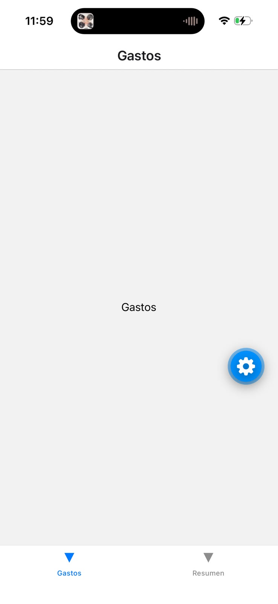

### T03 — Instrucciones para el agente (`AGENTS.md` y `CLAUDE.md`)

- **Prompt:** "listo" (continuar con la tarea T03 de `tasks.md`).
- **Qué hizo la IA:** creó en la raíz del repositorio:
  - [`AGENTS.md`](AGENTS.md): resumen de la constitución para cualquier agente (dónde está cada
    cosa, las 6 reglas, convenciones de código y qué revisar antes de terminar una tarea).
  - [`CLAUDE.md`](CLAUDE.md): una sola línea, `@AGENTS.md`. Claude Code lee `CLAUDE.md`
    automáticamente y la `@` le indica que incluya el contenido de `AGENTS.md`. Así las reglas
    están escritas una sola vez y sirven para cualquier agente.
  - Además se instalaron 3 skills oficiales de Expo en `.claude/skills/` (ver 4.2).
- **Qué corregimos / agregamos:** sumamos dos cosas que aprendimos en T01 y T02: que hay que usar
  `npx expo start --tunnel` por la red Wi-Fi, y que `gestor-gastos/` tiene su propio `AGENTS.md`
  de Expo que el agente también tiene que leer.
- **Cómo lo verificamos:** comparamos `AGENTS.md` con la constitución, regla por regla.

### T04 — Tipos de datos (`types/gasto.ts`)

- **Prompt:** "listo" (continuar con la tarea T04 de `tasks.md`; la tarea ya detalla cada tipo).
- **Qué hizo la IA:** creó [`gestor-gastos/types/gasto.ts`](gestor-gastos/types/gasto.ts) con:
  - `Categoria`: las 6 categorías fijas como tipo (`'Comida' | 'Transporte' | ...`), así TypeScript
    marca error si se escribe una categoría que no existe.
  - `CATEGORIAS`: la misma lista como arreglo, para dibujar los botones del formulario.
  - `Gasto`: lo que se guarda (monto en centavos enteros y fecha `AAAA-MM-DD`).
  - `DatosGasto`: un `Gasto` sin `id` (`Omit<Gasto, 'id'>`), porque el `id` lo pone el servicio.
  - `ValoresFormulario` y `ErroresFormulario`: lo que se escribe en el formulario (todo texto) y
    un mensaje de error por campo.
- **Qué corregimos:** nada; coincide con `data-model.md`.
- **Cómo lo verificamos:** `npx tsc --noEmit` sin errores. Esta tarea no cambia nada visible: en el
  teléfono la app sigue abriendo igual.

### T05 — Formato de pesos y fechas (`utils/formato.ts`)

- **Prompt:** "listo" (continuar con la tarea T05 de `tasks.md`).
- **Qué hizo la IA:** creó [`gestor-gastos/utils/formato.ts`](gestor-gastos/utils/formato.ts)
  con 6 funciones puras: `formatearPesos` (`150050` → `$ 1.500,50`), `textoACentavos`
  (`"1500,50"` → `150050`), `centavosATexto`, `fechaAMostrar` (`2026-10-23` → `23/10/2026`),
  `fechaAGuardar` (al revés) y `hoy()`.
- **Decisiones que revisamos:**
  - `formatearPesos` pone los puntos de miles con un bucle simple en vez de `Intl.NumberFormat`
    (su resultado cambia según el teléfono) o de una expresión regular (difícil de explicar).
  - `textoACentavos` usa `Math.round` porque `1.1 * 100` da `110.00000000000001` en JavaScript.
  - `hoy()` arma la fecha con la hora local; `toISOString()` usa la hora de Greenwich y después de
    las 21 h en Argentina devolvería el día siguiente.
- **Qué corregimos:** nada en las funciones.
- **Cómo lo verificamos:**
  1. En la computadora, 14 casos con resultado esperado (miles, millones, `$ 0,05`, coma y punto
     decimal, `"1,1"` → `110`): todos correctos.
  2. En el teléfono, una prueba **temporal** en la pantalla Gastos con 3 resultados (después se
     borró, como indica la tarea):

  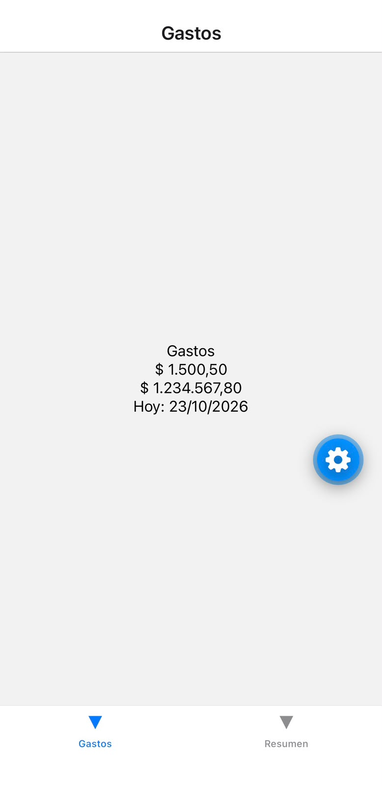

### T06 — Simulación del servidor y datos de ejemplo

- **Prompt:** "listo" (continuar con la tarea T06 de `tasks.md`).
- **Qué hizo la IA:**
  - [`services/simulacion.ts`](gestor-gastos/services/simulacion.ts): `esperar()` (una `Promise`
    que se resuelve con `setTimeout` después de 500–1000 ms al azar), `PROBABILIDAD_ERROR = 0` y
    `simularError()`, que lanza un error con esa probabilidad (para la demo del estado de error se
    pone en `1`).
  - [`services/datosEjemplo.ts`](gestor-gastos/services/datosEjemplo.ts): `crearDatosEjemplo()`
    devuelve 12 gastos (7 del mes actual y 5 del anterior) con las 6 categorías y 2 con nota. Las
    fechas se calculan a partir de hoy con `fechaDelMes(mesesAtras, dia)`.
- **Qué corregimos / cambiamos:**
  - Para armar las fechas hacía falta convertir un `Date` a `AAAA-MM-DD`, lo mismo que ya hacía
    `hoy()`. En vez de copiar ese código, se separó en una función nueva `fechaATexto(fecha)` en
    `utils/formato.ts` y `hoy()` ahora la usa.
  - **Caso borde detectado al planificar las pruebas:** si hoy es el día 3 del mes, un gasto "del
    día 15" sería una fecha futura (no permitida por la spec). Por eso en el mes actual el día se
    limita a hoy, y en el mes anterior al último día de ese mes (por ejemplo, febrero tiene 28 o 29).
- **Cómo lo verificamos:** `npx tsc --noEmit` sin errores, y en la computadora se generaron los
  datos simulando 4 fechas distintas como "hoy" (1/1/2027, 31/3/2027, 31/3/2028 —año bisiesto— y
  23/10/2026). En todas: 12 gastos, 7 del mes actual, 0 fechas futuras, 6 categorías, ids sin
  repetir. Esta tarea no cambia nada visible en el teléfono; se ve funcionando en T07.

### T07 — Servicio de gastos con AsyncStorage (`services/gastos.ts`)

- **Prompt:** "listo" (continuar con la tarea T07 de `tasks.md`).
- **Qué hizo la IA:**
  1. Instaló AsyncStorage con `npx expo install @react-native-async-storage/async-storage`.
  2. Creó [`services/gastos.ts`](gestor-gastos/services/gastos.ts) con las 5 funciones del
     [contrato](specs/001-gestor-gastos/contracts/servicio-gastos.md): `obtenerGastos`,
     `obtenerGasto`, `crearGasto`, `actualizarGasto` y `eliminarGasto`. Todas esperan 500–1000 ms y
     pueden fallar (`simularError`). La lista se guarda como JSON en una sola clave, `gastos`; si la
     clave no existe se cargan los datos de ejemplo.
- **Qué salió mal y cómo se resolvió:** la instalación falló con `npm error ERESOLVE`. Causa:
  `react-dom` (que expo-router usa para la versión web) publicó la versión 19.3.1, que exige
  `react` 19.3.1, pero Expo SDK 58 fija `react` en 19.3.0. Solución: fijar `react-dom` en la
  versión del SDK con `npx expo install react-dom @react-native-async-storage/async-storage`
  (queda `react-dom` 19.3.0). Después `npx expo-doctor` pasó los 20 controles. Como se agregaron
  paquetes, hubo que reiniciar Expo con `npx expo start --tunnel -c`.
- **Qué corregimos / agregamos:** `crearGasto` agrega el gasto nuevo **al principio** de la lista,
  así entre gastos con la misma fecha el más nuevo aparece primero (lo pide la prueba de la
  Historia 3: "el gasto aparece primero en la lista").
- **Cómo lo verificamos:**
  1. En la computadora, con un AsyncStorage simulado: la primera carga trae 12 gastos ordenados
     (tardó 757 ms); crear → 13 y el nuevo queda primero; editar cambia la descripción; eliminar →
     12 y buscarlo devuelve `null`; editar un id inexistente da "No se encontró el gasto"; borrar
     todo → 0, y **los ejemplos no vuelven** (supuesto de la spec).
  2. En el teléfono, prueba temporal en la pantalla Gastos (se ve "Cargando…" y después la
     cantidad; luego se borró):

  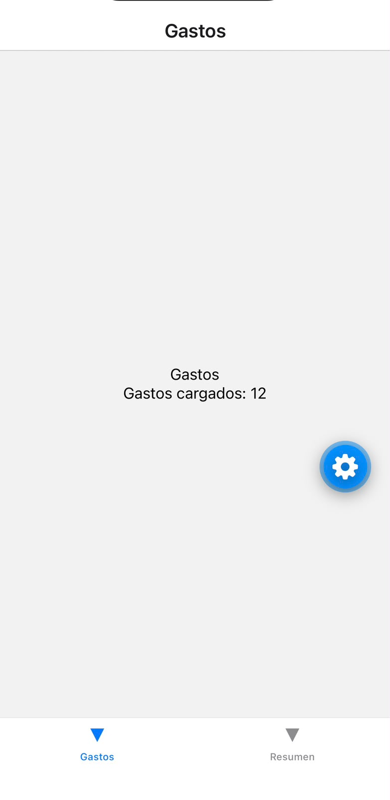

### T08 — Componentes de estado (carga, vacío y error)

- **Prompt:** "listo" (continuar con la tarea T08 de `tasks.md`).
- **Qué hizo la IA:** creó tres componentes reutilizables en
  [`gestor-gastos/components/`](gestor-gastos/components/), que usan todas las pantallas con
  datos (constitución, principio IV):
  - `Cargando.tsx`: ruedita (`ActivityIndicator`) + texto, por defecto "Cargando…".
  - `MensajeVacio.tsx`: mensaje y, **opcionalmente**, un botón (solo se dibuja si recibe
    `textoBoton` y `alPresionar`).
  - `MensajeError.tsx`: "Algo salió mal", el mensaje del error y el botón "Reintentar".
- **Decisiones que revisamos:** los botones son `Pressable` con estilo propio en vez del `Button`
  de React Native, porque `Button` se ve distinto en iPhone y en Android y casi no se puede
  personalizar.
- **Qué corregimos:** nada.
- **Cómo lo verificamos:** `npx tsc --noEmit` sin errores y una prueba **temporal** en la pestaña
  Resumen con los tres componentes juntos (después se dejó la pantalla como estaba):

  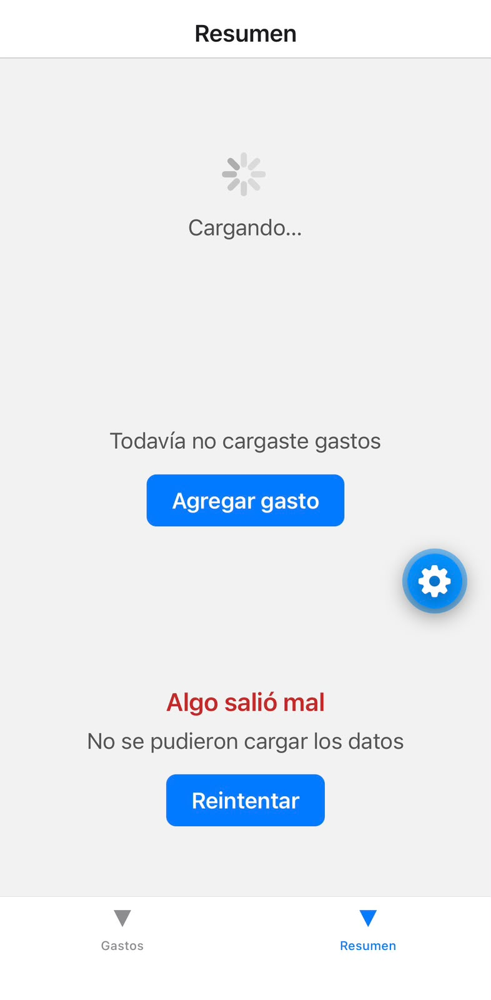

### T09 — Total del mes (`utils/calculos.ts`)

- **Prompt:** "listo" (continuar con la tarea T09 de `tasks.md`).
- **Qué hizo la IA:** creó [`utils/calculos.ts`](gestor-gastos/utils/calculos.ts) con
  `totalDelMes(gastos)`: recorre la lista con un `for` y suma `montoCentavos` solo de los gastos
  cuya fecha empieza con el `AAAA-MM` de hoy (por ejemplo `"2026-10"`).
- **Decisiones que revisamos:** se usa un `for` común en vez de `filter` + `reduce` porque es más
  fácil de leer y explicar. Comparar el texto de la fecha (`startsWith`) funciona gracias a que las
  fechas se guardan como `AAAA-MM-DD`.
- **Qué corregimos:** nada.
- **Cómo lo verificamos:** `npx tsc --noEmit` sin errores y, en la computadora, con los datos de
  ejemplo: `totalDelMes` dio **$ 127.351,25**, igual a la suma manual de los 7 gastos del mes; con
  la lista vacía da 0 y con solo gastos del mes anterior da 0. En el teléfono se ve en T11.

### T10 — Tarjeta de cada gasto (`components/TarjetaGasto.tsx`)

- **Prompt:** "listo" (continuar con la tarea T10 de `tasks.md`).
- **Qué hizo la IA:** creó [`components/TarjetaGasto.tsx`](gestor-gastos/components/TarjetaGasto.tsx):
  una fila (`Pressable`) con la descripción y "categoría · fecha" a la izquierda y el monto a la
  derecha, usando `fechaAMostrar` y `formatearPesos` de T05.
- **Decisiones que revisamos:**
  - `flexDirection: 'row'` para poner texto y monto lado a lado, y `flex: 1` en la parte izquierda
    para que el monto quede siempre a la derecha.
  - `numberOfLines={1}` en la descripción: si es muy larga se corta con "…" en vez de empujar el
    monto.
  - Al mantener apretada la tarjeta baja la opacidad, para que el usuario note que se puede tocar.
- **Qué corregimos:** nada.
- **Cómo lo verificamos:** `npx tsc --noEmit` sin errores y una prueba **temporal** en la pestaña
  Gastos con los 2 primeros gastos de ejemplo (después se borró):

  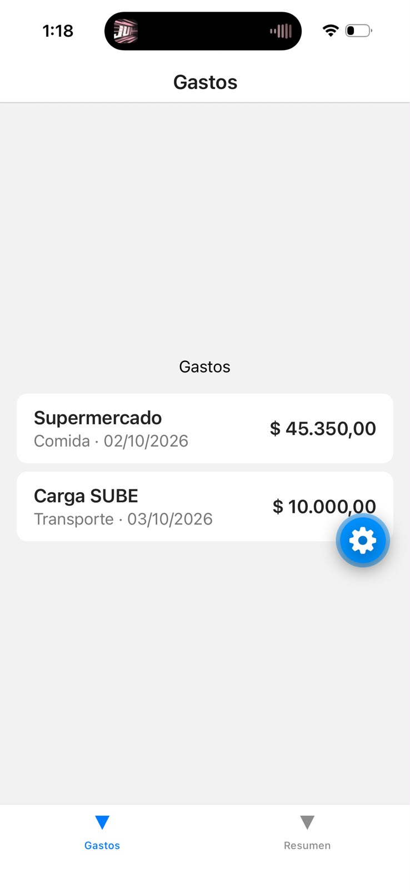

### T11 — Pantalla de lista de gastos (MVP)

- **Prompt:** "listo" (continuar con la tarea T11 de `tasks.md`).
- **Qué hizo la IA:**
  1. Antes de escribir, revisó en la documentación de expo-router de SDK 58 (en
     `node_modules/expo-router`) cómo se usa `useFocusEffect`: hay que envolver la función en
     `useCallback`.
  2. Reescribió [`app/(tabs)/index.tsx`](gestor-gastos/app/(tabs)/index.tsx): carga los gastos
     con `obtenerGastos()` dentro de `useFocusEffect` (se ejecuta cada vez que la pantalla vuelve a
     verse), guarda el resultado en `useState` y muestra, en este orden: error con "Reintentar",
     "Cargando…" (mientras `gastos` es `null`), "Todavía no cargaste gastos" (lista vacía) o el
     total del mes arriba + `FlatList` de `TarjetaGasto`.
- **Decisiones que revisamos:**
  - `gastos` empieza en `null` y no en `[]`: así se distingue "todavía no llegaron los datos"
    (carga) de "llegaron y no hay ninguno" (vacío).
  - `FlatList` en vez de `ScrollView`: solo dibuja las filas visibles, así una lista larga no se
    traba (caso borde de la spec).
  - El total va en `ListHeaderComponent` para que se desplace junto con la lista.
  - Tocar una tarjeta todavía no hace nada; el detalle se agrega en T12. El botón "Agregar gasto"
    se agrega en T16, como indica `tasks.md`.
- **Qué corregimos:** nada.
- **Cómo lo verificamos (escenarios de `quickstart.md`):**
  - 1, 2, 3, 4 y 19: se ve "Cargando…", después el total **$ 127.351,25** (coincide con la suma
    de T09) y los 12 gastos del más nuevo al más viejo; la lista se desplaza bien.
  - 18 (error): con `PROBABILIDAD_ERROR = 1` aparece "Algo salió mal" y "Reintentar"; al volver a
    `0` y tocar "Reintentar", la lista vuelve.

  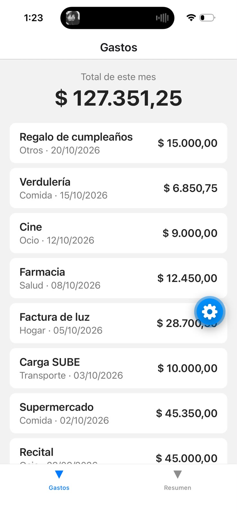
  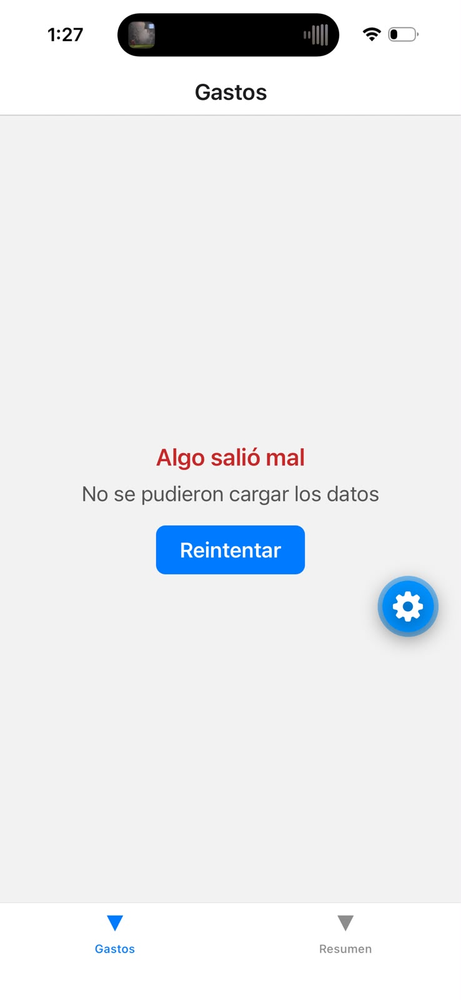

- **Qué salió mal después:** el commit de T11 se hizo con `PROBABILIDAD_ERROR = 1` (el archivo
  quedó así después de la prueba del error), así que la app fallaba siempre. Lo detectamos al
  revisar el commit (`git show --stat` mostraba `simulacion.ts` modificado) y lo corregimos con un
  commit `fix:` que lo vuelve a `0`. **Aprendizaje:** antes de cada commit, mirar `git status` y
  revisar que no se cuelen cambios de prueba.

### T12 — Pantalla de detalle (`app/gasto/[id].tsx`)

- **Prompt:** "listo" (continuar con la tarea T12 de `tasks.md`).
- **Qué hizo la IA:**
  - Creó [`app/gasto/[id].tsx`](gestor-gastos/app/gasto/[id].tsx). Los corchetes hacen que esa
    parte de la ruta sea variable: `/gasto/ejemplo-3` abre el gasto con `id = "ejemplo-3"`, que se
    lee con `useLocalSearchParams`. Carga el gasto con `obtenerGasto(id)` dentro de
    `useFocusEffect` y muestra carga, error con "Reintentar", "No se encontró el gasto" con
    "Volver" (si el servicio devuelve `null`) o los datos. La nota solo se muestra si tiene texto.
  - En [`app/_layout.tsx`](gestor-gastos/app/_layout.tsx) le dio el título "Detalle" y puso
    "Atrás" como texto del botón para volver.
  - En la lista, tocar una tarjeta ahora hace `router.push(`/gasto/${id}`)`.
- **Qué salió mal y qué corregimos:** en el iPhone, el monto y la descripción quedaban
  **escondidos detrás del encabezado**, porque en las versiones nuevas de iOS el encabezado es
  transparente y el contenido empieza debajo de él. Se corrigió agregando
  `contentInsetAdjustmentBehavior="automatic"` al `ScrollView`, que le indica a iOS que deje el
  espacio del encabezado. (La lista no tenía este problema porque el encabezado de las pestañas no
  es transparente.)
- **Cómo lo verificamos:** escenario 5 de `quickstart.md`: al tocar un gasto se abre el detalle
  por encima de las pestañas, "Atrás" vuelve a la lista, el gasto con nota la muestra y el gasto
  sin nota no muestra esa fila. "No se encontró el gasto" se prueba en T18 (todavía no se puede
  borrar un gasto).

  Antes y después de la corrección:

  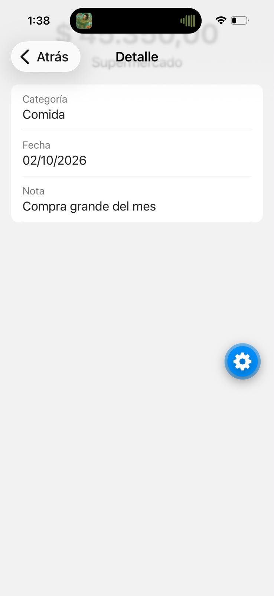
  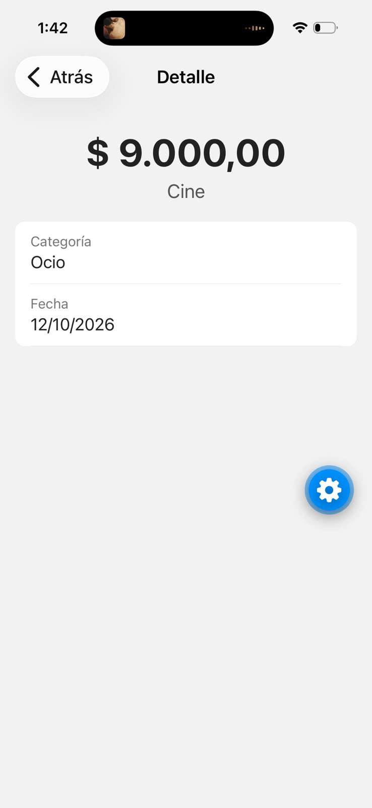

### T13 — Validación del formulario (`utils/validacion.ts`)

- **Prompt:** "listo" (continuar con la tarea T13 de `tasks.md`; la tarea copia textualmente las
  reglas y los mensajes de FR-006 / `data-model.md`).
- **Qué hizo la IA:** creó [`utils/validacion.ts`](gestor-gastos/utils/validacion.ts) con
  `validarGasto(valores)`, una función pura que devuelve un objeto con un mensaje por cada campo
  con error (`{}` = se puede guardar). Cada campo tiene su función (`validarDescripcion`,
  `validarMonto`, `validarFecha`) que devuelve el mensaje de la **primera** regla que falla, o
  `null`.
- **Decisiones que revisamos:**
  - **Monto:** una expresión regular (`/^-?\d+([.,]\d+)?$/`) acepta números con coma o punto
    decimal. Acepta el signo `-` para que `-5` diga "debe ser mayor a 0" (más claro que "no es un
    número"). Un monto con separador de miles (`1.500,50`) **no** se acepta: así lo define
    `data-model.md` (la coma o el punto es el decimal) y el mensaje "debe ser un número" lo indica.
  - **Fecha real:** se crea un `Date` con día, mes y año, y se revisa si cambió. JavaScript
    "acomoda" las fechas imposibles: el 31/02/2026 lo convierte en 03/03/2026; si cambió, la fecha
    no existe. Esto también resuelve los años bisiestos sin código extra.
  - **Fecha futura:** se compara como texto `AAAA-MM-DD` con `hoy()`, igual que en T09.
- **Qué corregimos:** nada.
- **Cómo lo verificamos:** `npx tsc --noEmit` sin errores y **22 casos** en la computadora
  (todos correctos), entre ellos los del escenario 8 de `quickstart.md`: descripción `"  ab "`,
  montos `0`, `-5`, `abc`, `10,555` y `20000000`, fecha `31/02/2026`, fecha de mañana, nota de
  201 caracteres; y los límites que sí valen: 50 caracteres, `10000000`, 200 caracteres de nota y
  `29/02/2024` (año bisiesto). En el teléfono se ve en T16, cuando el formulario esté conectado.

### T14 — Selector de categoría (`components/SelectorCategoria.tsx`)

- **Prompt:** "listo" (continuar con la tarea T14 de `tasks.md`).
- **Qué hizo la IA:** creó [`components/SelectorCategoria.tsx`](gestor-gastos/components/SelectorCategoria.tsx):
  recorre `CATEGORIAS` con `.map()` y dibuja un `Pressable` por categoría; el elegido se pinta de
  azul. Con `flexWrap: 'wrap'` los botones que no entran pasan a la fila de abajo.
- **Decisiones que revisamos:** es un componente **controlado**: no guarda cuál está elegida, la
  recibe en `valor` y avisa los cambios con `alCambiar`. La categoría la guarda la pantalla del
  formulario, que la necesita para validar y guardar. Se usan botones y no un menú desplegable
  porque son solo 6 opciones fijas y así no hace falta otra librería (`research.md` §12).
- **Qué corregimos:** nada.
- **Cómo lo verificamos:** `npx tsc --noEmit` sin errores y una prueba **temporal** en la pestaña
  Resumen: al tocar "Salud" se resalta y al tocar "Ocio" se resalta Ocio y Salud vuelve a blanco
  (solo una elegida). Después se dejó la pantalla como estaba.

  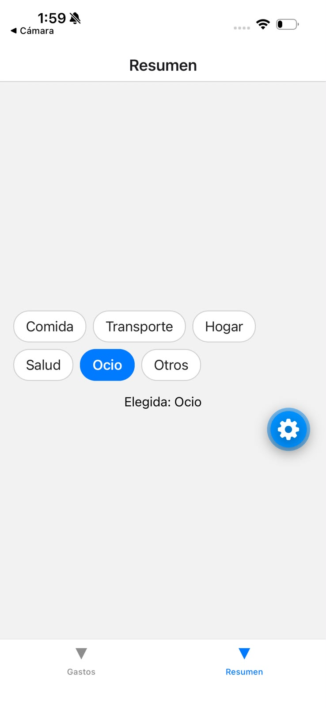

### T15 — Formulario para agregar un gasto (`app/gasto/formulario.tsx`)

- **Prompt:** "listo" (continuar con la tarea T15 de `tasks.md`).
- **Qué hizo la IA:** creó [`app/gasto/formulario.tsx`](gestor-gastos/app/gasto/formulario.tsx)
  (título "Nuevo gasto" en `app/_layout.tsx`):
  - Guarda todo lo escrito en **un solo objeto** `valores` (`useState<ValoresFormulario>`); la
    función `cambiar(campo, valor)` actualiza un campo y deja los demás igual. La fecha empieza
    con la de hoy.
  - Un componente `Campo` (etiqueta + `TextInput` + mensaje de error en rojo) que se repite para
    descripción, monto (teclado numérico), fecha y nota (multilínea), y el `SelectorCategoria`.
  - Al tocar "Guardar": `validarGasto`; si hay errores los muestra y no guarda; si no, deshabilita
    el botón ("Guardando…"), llama a `crearGasto` con los datos convertidos (`trim`,
    `textoACentavos`, `fechaAGuardar`) y vuelve con `router.back()`. Si el servicio falla,
    muestra el error arriba del botón y lo vuelve a habilitar.
- **Decisiones que revisamos:**
  - **Doble toque en "Guardar"** (caso borde de la spec): además de deshabilitar el botón se usa
    `useRef`. `useState` recién cambia en el siguiente dibujo de la pantalla, así que dos toques
    muy rápidos podrían pasar los dos; `useRef` cambia al instante.
  - `valores.categoria!`: el `!` le dice a TypeScript "acá no es `null`". Es seguro porque
    `validarGasto` ya lo comprobó antes.
  - Por lo aprendido en T12, el `ScrollView` lleva `contentInsetAdjustmentBehavior="automatic"`
    (encabezado transparente de iOS) y `automaticallyAdjustKeyboardInsets` (que el teclado no tape
    el campo).
- **Qué corregimos:** nada.
- **Cómo lo verificamos:** `npx tsc --noEmit` sin errores. Todavía no hay un botón que lleve a
  esta pantalla: la prueba completa en el teléfono se hace en T16 (como indica `tasks.md`).

### T16 — Botón "Agregar gasto" (y prueba completa del formulario)

- **Prompt:** "listo" (continuar con la tarea T16 de `tasks.md`).
- **Qué hizo la IA:** en [`app/(tabs)/index.tsx`](gestor-gastos/app/(tabs)/index.tsx) agregó la
  función `irAAgregar()` (`router.push('/gasto/formulario')`) y la usa en dos lugares: un botón
  **"+ Agregar gasto"** debajo del total del mes, y el botón del estado vacío ("Todavía no
  cargaste gastos" → "Agregar gasto"), que pide la Historia 1.
- **Qué corregimos:** nada.
- **Cómo lo verificamos (escenarios 6 a 10 de `quickstart.md`, en el iPhone):**
  - **6:** "+ Agregar gasto" abre "Nuevo gasto" con la fecha de hoy ya escrita.
  - **7:** con todo vacío, "Guardar" no guarda y muestra 4 mensajes en rojo (descripción, monto,
    categoría y fecha), con el borde de cada campo en rojo.
  - **10:** se cargó un gasto real ("Crossfit", $ 50.000, Otros, nota "Box"): aparece **primero y
    una sola vez**, el total pasó de $ 127.351,25 a **$ 177.351,25** (justo $ 50.000 más) y el
    detalle muestra todos los datos.
  - **8:** los mensajes de cada regla ya se habían probado en T13 con 22 casos.

  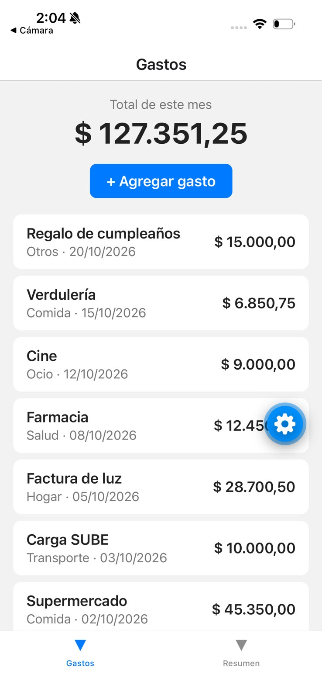
  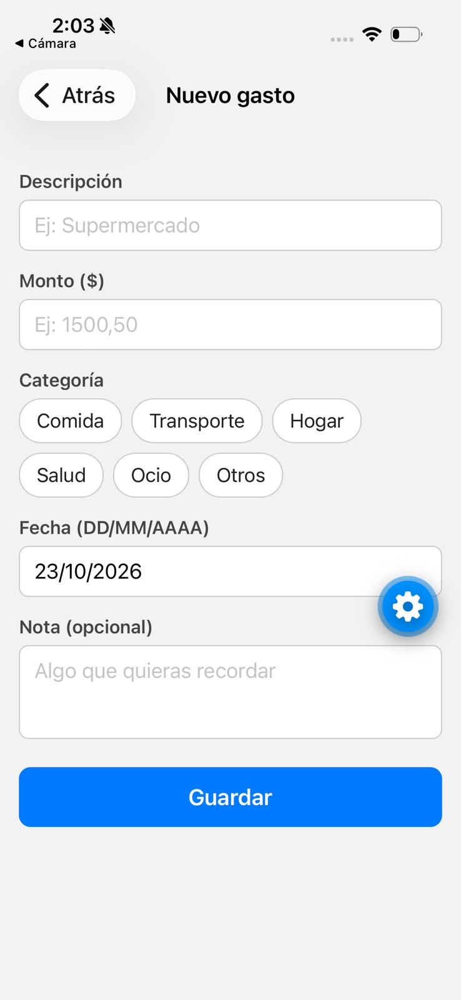
  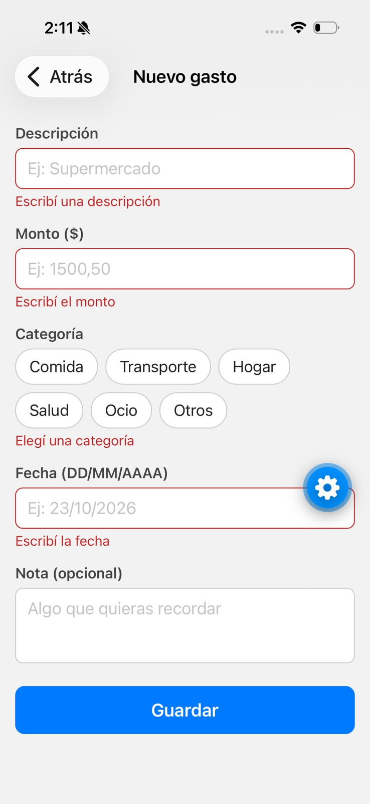
  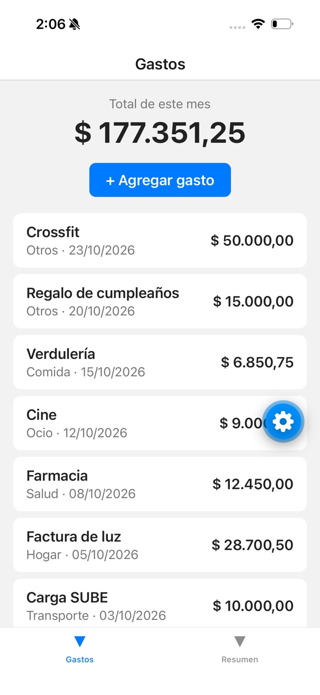

### T17 — Editar un gasto (mismo formulario, modo edición)

- **Prompt:** "listo" (continuar con la tarea T17 de `tasks.md`).
- **Qué hizo la IA:**
  - En [`app/gasto/formulario.tsx`](gestor-gastos/app/gasto/formulario.tsx): lee un `id`
    opcional de la ruta (`/gasto/formulario?id=...`). Si lo hay, el título pasa a "Editar gasto"
    (con `<Stack.Screen options>` dentro de la pantalla), trae el gasto con `obtenerGasto`,
    completa los campos (`centavosATexto`, `fechaAMostrar`) y al guardar llama a
    `actualizarGasto` en vez de `crearGasto`. Mientras carga muestra `Cargando`; si falla,
    `MensajeError` con "Reintentar"; si no existe, "No se encontró el gasto".
  - En [`app/gasto/[id].tsx`](gestor-gastos/app/gasto/[id].tsx): botón "Editar" que abre el
    formulario con el id del gasto.
- **Decisiones que revisamos:**
  - **Un solo formulario para los dos modos** (FR-008: "el mismo formulario y las mismas
    validaciones"): no se duplica código.
  - El gasto a editar se carga con `useEffect` (una vez, al abrir) y **no** con `useFocusEffect`:
    si se recargara al volver a la pantalla, se borraría lo que el usuario ya había cambiado.
  - Después de guardar, `router.back()` vuelve al detalle, que se actualiza solo gracias a su
    `useFocusEffect` (T12).
- **Qué corregimos:** al agregar el código del modo edición la sangría del formulario quedó
  desalineada; se acomodó con Prettier (`npx prettier --single-quote --print-width 100`), el
  formateador que usa Expo.
- **Cómo lo verificamos:** `npx tsc --noEmit` sin errores y escenario 11 de `quickstart.md`: se
  editó "Crossfit" de $ 50.000 a $ 45.000; el formulario se abrió con todos los datos (incluida la
  categoría marcada) y al guardar el detalle mostró el monto nuevo.

  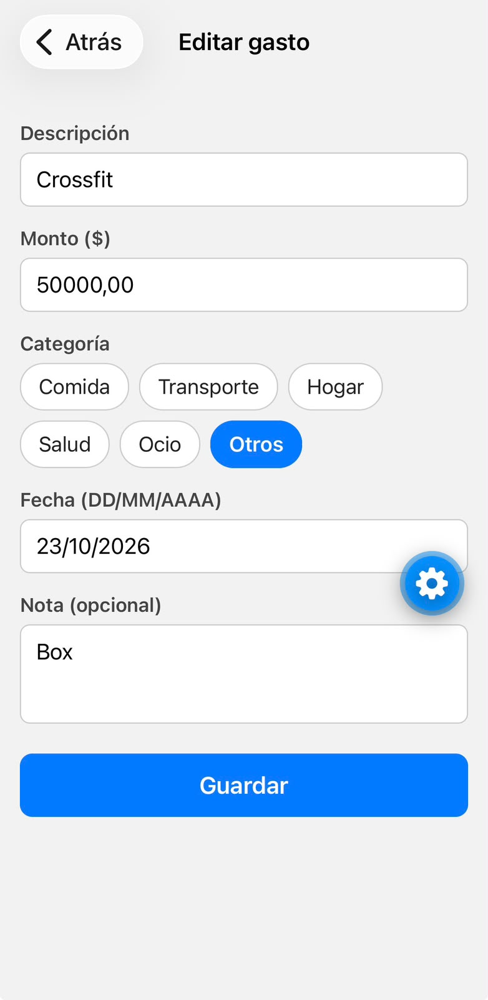
  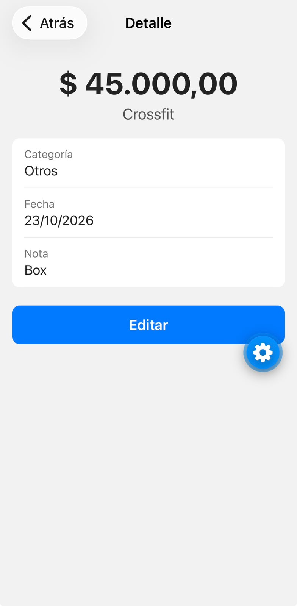

### T18 — Eliminar un gasto (con confirmación)

- **Prompt:** "listo" (continuar con la tarea T18 de `tasks.md`).
- **Qué hizo la IA:** en [`app/gasto/[id].tsx`](gestor-gastos/app/gasto/[id].tsx) agregó el botón
  "Eliminar" debajo de "Editar". Al tocarlo, `Alert.alert` muestra el aviso nativo "¿Eliminar este
  gasto?" con "Cancelar" (`style: 'cancel'`) y "Eliminar" (`style: 'destructive'`, en rojo). Solo
  "Eliminar" llama a `eliminarGasto(id)`; mientras tanto el botón dice "Eliminando…" y queda
  deshabilitado, y al terminar vuelve a la lista con `router.back()`. Si el servicio falla, muestra
  otro aviso con el error.
- **Decisiones que revisamos:** "Eliminar" es blanco con borde y letras rojas (y no un botón lleno
  como "Editar") para que no se confunda ni se toque por error.
- **Qué corregimos:** nada.
- **Cómo lo verificamos (escenarios 12 y 13 de `quickstart.md`):** con el gasto "Crossfit": al
  tocar "Cancelar" el aviso se cierra y el gasto queda igual; al confirmar "Eliminar" se vuelve a la
  lista y el gasto ya no aparece. El estado vacío (borrar todos) y "No se encontró el gasto" quedan
  para la prueba completa de T21.

  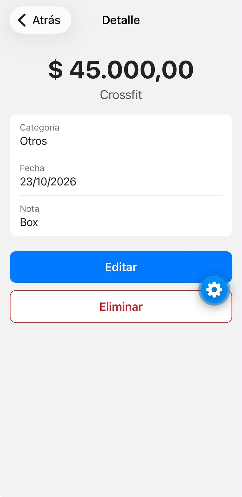
  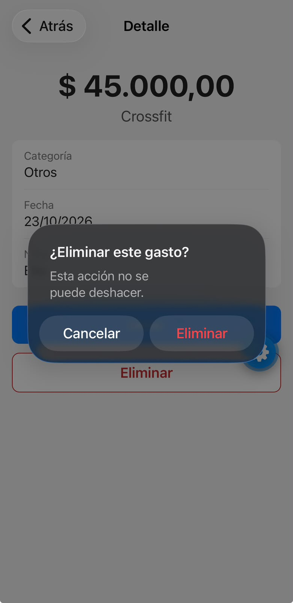

### T19 — Resumen por categoría (`utils/calculos.ts`)

- **Prompt:** "listo" (continuar con la tarea T19 de `tasks.md`).
- **Qué hizo la IA:** agregó a [`utils/calculos.ts`](gestor-gastos/utils/calculos.ts) el tipo
  `ResumenCategoria` y la función `resumenPorCategoria(gastos)`: para cada una de las 6
  categorías suma los gastos del mes actual; si la suma es mayor a 0 la agrega con su porcentaje
  sobre el total del mes (`Math.round(total * 100 / totalMes)`), y al final ordena de mayor a menor.
- **Decisiones que revisamos:** los porcentajes se redondean a entero, como define
  `data-model.md`. Por eso **pueden sumar 99 % o 101 %**: con los datos de ejemplo suman 101 %
  (cada uno se redondea por separado). Lo aceptamos: lo que tiene que coincidir "al centavo"
  (SC-003) son los **montos**, y esos sí suman exactamente el total del mes.
- **Qué corregimos:** nada.
- **Cómo lo verificamos:** `npx tsc --noEmit` sin errores y, en la computadora, con los datos de
  ejemplo: Comida $ 52.200,75 (41 %), Hogar $ 28.700,50 (23 %), Otros $ 15.000 (12 %), Salud
  $ 12.450 (10 %), Transporte $ 10.000 (8 %), Ocio $ 9.000 (7 %). La suma de las categorías da
  $ 127.351,25, igual a `totalDelMes`. Con la lista vacía devuelve `[]`. En el teléfono se ve en
  T20.

### T20 — Pantalla de resumen (`app/(tabs)/resumen.tsx`)

- **Prompt:** "listo" (continuar con la tarea T20 de `tasks.md`).
- **Qué hizo la IA:** reescribió [`app/(tabs)/resumen.tsx`](gestor-gastos/app/(tabs)/resumen.tsx)
  con el mismo esquema que la lista (T11): carga los gastos con `obtenerGastos()` dentro de
  `useFocusEffect`, muestra carga / error con "Reintentar" / "No hay gastos este mes" (si
  `resumenPorCategoria` devuelve una lista vacía), y si hay datos: el total del mes arriba y una
  fila por categoría con su total y su porcentaje.
- **Decisiones que revisamos:** la pantalla no guarda datos propios: pide los mismos gastos que la
  lista y los resume con la función de T19, así nunca puede "desincronizarse". No tiene gráficos
  porque quedaron fuera de alcance en la spec (FR-010 pide totales y porcentajes). Se usa
  `ScrollView` y `.map()` en vez de `FlatList` porque como máximo hay 6 filas.
- **Qué corregimos:** nada.
- **Cómo lo verificamos (escenarios 14 y 15 de `quickstart.md`):** se agregó un gasto de $ 45.000
  en "Otros" y al volver a "Resumen" Otros pasó de $ 15.000 a **$ 60.000** y quedó primero
  (35 %), el total pasó de $ 127.351,25 a **$ 172.351,25** y los porcentajes se recalcularon. La
  suma de las 6 categorías coincide con el total del mes.

  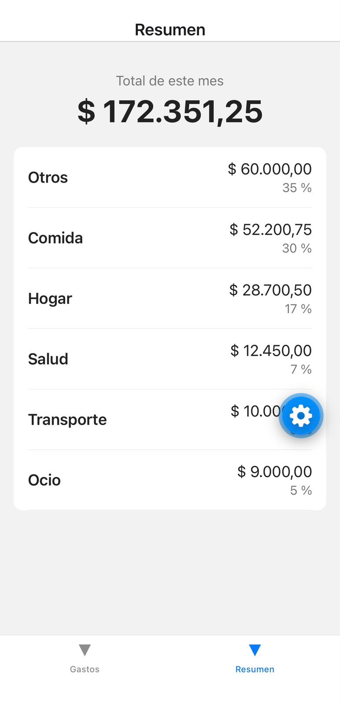

---

## Registro de prompts generales

| Etapa | Prompt utilizado (a Claude Code) | Resultado |
|---|---|---|
| 0 | "quiero que me hagas este trabajo de una forma fácil para que yo pueda entenderlo y luego explicarle a mis profesores [...]" + PDF de la consigna | La IA propuso un plan por etapas, clonó el repositorio y creó la estructura de este documento. |
| 1 | "quiero que vos hagas todo y me digas cuándo tengo que hacer commit" | La IA redactó un borrador de la investigación con fuentes. Lo revisamos y reescribimos con nuestras palabras. |
| 2 | "siguiente" (continuar con la etapa 2) + los prompts de la sección 2.3 | La IA instaló Spec Kit, escribió la constitución y generó la spec. |
| 3 | "listo" (continuar con la etapa 3) + los prompts de la sección 3.1 | La IA generó el plan técnico, los documentos de diseño y las 22 tareas; corrigió la constitución a 1.0.1 por ser trabajo individual. |

---

## 6. Conclusiones


